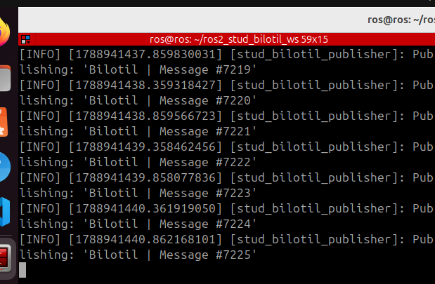
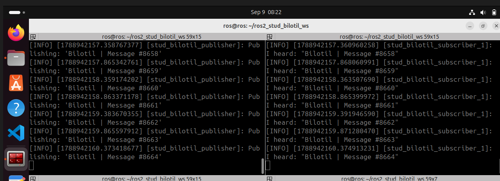
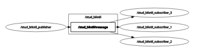
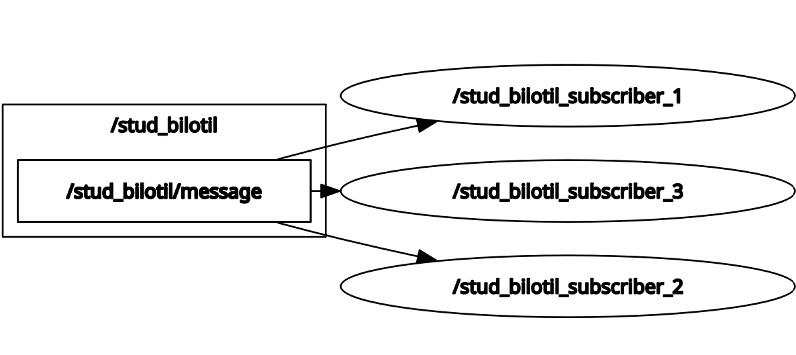
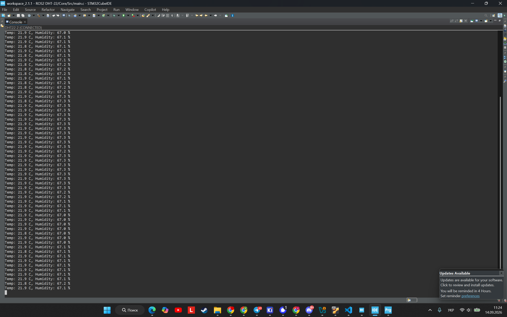

# Самостійна робота 1. ROS 2: workspace, ООП-nodes та ESP32 через micro-ROS

**Студент:** Artem Bilotil
**Група:** Рт-2

**Workspace:** `ros2_stud_bilotil_ws`
**Пакет C++:** `stud_bilotil_cpp_pkg`
**Пакет Python:** `stud_bilotil_py_pkg`
**Основний topic (текстові повідомлення):** `/stud_bilotil/message`


---

## Схема системи (поточний стан, Етапи 1–7)

```text
                 ros2_stud_bilotil_ws
                          │
         ┌────────────────┴────────────────┐
         │                                  │
  stud_bilotil_cpp_pkg              stud_bilotil_py_pkg
         │                                  │
 stud_bilotil_publisher      stud_bilotil_subscriber_1/2/3
         │                                  │
         └────────► /stud_bilotil/message ◄─┘
```

---

## 1. Правило іменування

| Об'єкт                        | Ім'я                                   |
|-------------------------------|----------------------------------------|
| Workspace                     | `ros2_stud_bilotil_ws`                 |
| C++ package                   | `stud_bilotil_cpp_pkg`                 |
| Python package                | `stud_bilotil_py_pkg`                  |
| Node — publisher              | `stud_bilotil_publisher`               |
| Node — subscriber             | `stud_bilotil_subscriber`              |
| Node — монітор температури    | `stud_bilotil_temperature_monitor`     |
| Node на мікроконтролері       | `stud_bilotil_esp32`                   |
| Topic — текстові повідомлення | `/stud_bilotil/message`                |
| Topic — температура, °C       | `/stud_bilotil/temperature/celsius`    |
| Topic — температура, °F       | `/stud_bilotil/temperature/fahrenheit` |

---

## 2. Стиль коду

Обидва nodes реалізовано класами:

- `StudentPublisher` успадковує `rclcpp::Node` (C++), усі ROS-сутності (`publisher_`,
  `timer_`, `counter_`) — приватні поля класу, `main()` містить лише
  `rclcpp::init()` → `std::make_shared<StudentPublisher>()` → `rclcpp::spin()` →
  `rclcpp::shutdown()`.
- `StudentSubscriber` успадковує `rclpy.node.Node` (Python), конструктор викликає
  `super().__init__(...)`, `listener_callback` — метод класу.

---

## 3. Етап 1. Власний workspace

### Структура каталогів

| Каталог | Опис |
|---|---|
| `src` | Містить початковий вихідний код (source code) усіх створених або завантажених пакетів ROS 2. |
| `build` | Використовується системою збірки `colcon` для зберігання проміжних файлів компіляції та конфігурації. |
| `install` | Містить готові зібрані виконувані файли, бібліотеки, скрипти та `setup.bash` для їх підключення до середовища. |
| `log` | Зберігає текстові файли журналів (логів) із детальним звітом про процес виконання команд `colcon build`. |

### Вивід перевірки

```text
ros@ros:~/ros2_stud_bilotil_ws$ printenv | grep ROS
ROS_VERSION=2
ROS_PYTHON_VERSION=3
ROS_AUTOMATIC_DISCOVERY_RANGE=SUBNET
ROS_DISTRO=jazzy

ros@ros:~/ros2_stud_bilotil_ws$echo$AMENT_PREFIX_PATH
/home/ros/ros2_stud_bilotil_ws/install/stud_bilotil_py_pkg:/home/ros/ros2_stud_bilotil_ws/install/stud_bilotil_cpp_pkg:/opt/ros/jazzy

### Чому `install/setup.bash` підключається після `/opt/ros/jazzy/setup.bash`, а не замість нього

Файл `install/setup.bash` локального workspace підключається після системного
`/opt/ros/jazzy/setup.bash`, оскільки ROS 2 працює за принципом каскадного накладання
середовищ (underlay / overlay). Системний ROS 2 надає базовий фреймворк, стандартні
бібліотеки та типи повідомлень, а локальний workspace будується поверх нього і
додає власні пакети. Послідовне підключення дописує шляхи локального workspace на
початок змінних оточення (наприклад, `AMENT_PREFIX_PATH`), при цьому зберігаючи
доступ до всіх системних ресурсів ROS 2.

---

## 4. Етап 2. Два packages

Створено два пакети у `~/ros2_stud_bilotil_ws/src/`:

| Package                | Build type    | Залежності          |
|------------------------|---------------|---------------------|
| `stud_bilotil_cpp_pkg` | `ament_cmake` | `rclcpp`, `std_msgs`|
| `stud_bilotil_py_pkg`  | `ament_python`| `rclpy`, `std_msgs` |

### Структура C++ package

```text
stud_bilotil_cpp_pkg/
├── include/
│   └── stud_bilotil_cpp_pkg/
│       └── student_publisher.hpp
├── src/
│   ├── student_publisher.cpp
│   └── main.cpp
├── CMakeLists.txt
└── package.xml
```

### Структура Python package

```text
stud_bilotil_py_pkg/
├── stud_bilotil_py_pkg/
│   ├── __init__.py
│   ├── student_subscriber.py
│   └── temperature_monitor.py
├── resource/
├── setup.py
├── setup.cfg
└── package.xml
```

### Перевірка (наявність обох пакетів)

```text
ros@ros:~/ros2_stud_bilotil_ws$ ros2 pkg list | grep bilotil
stud_bilotil_cpp_pkg
stud_bilotil_py_pkg
ros@ros:~/ros2_stud_bilotil_ws$ 

```


---

## 5. Етап 3. C++ Publisher

**Node:** `stud_bilotil_publisher`

| Параметр                        | Значення                |
|---------------------------------|-------------------------|
| Topic                           | `/stud_bilotil/message` |
| Тип повідомлення                | `std_msgs/msg/String`   |
| Частота | 2 Hz (таймер 500 мс)  |                         |
| Формат повідомлення             | `Bilotil  | Message #N` |

### Код `student_publisher.hpp`

```cpp
#ifndef STUDENT_PUBLISHER_HPP_
#define STUDENT_PUBLISHER_HPP_

#include "rclcpp/rclcpp.hpp"
#include "std_msgs/msg/string.hpp"

class StudentPublisher : public rclcpp::Node {
public:
    StudentPublisher();
private:
    void timer_callback();
    rclcpp::Publisher<std_msgs::msg::String>::SharedPtr publisher_;
    rclcpp::TimerBase::SharedPtr timer_;
    size_t counter_;
};

#endif 
```

### Код `student_publisher.cpp`

```cpp
#include "stud_bilotil_cpp_pkg/student_publisher.hpp"

StudentPublisher::StudentPublisher() : Node("stud_bilotil_publisher"), counter_(0) {
    publisher_ = this->create_publisher<std_msgs::msg::String>("/stud_bilotil/message", 10);
    timer_ = this->create_wall_timer(
        std::chrono::milliseconds(500),
        std::bind(&StudentPublisher::timer_callback, this)
    );
}

void StudentPublisher::timer_callback() {
    auto message = std_msgs::msg::String();
    message.data = "Bilotil | Message #" + std::to_string(counter_);
    RCLCPP_INFO(this->get_logger(), "Publishing: '%s'", message.data.c_str());
    publisher_->publish(message);
    counter_++;
} 
```

### Код `main.cpp`

```cpp
#include "stud_bilotil_cpp_pkg/student_publisher.hpp"

int main(int argc, char * argv[]) {
    rclcpp::init(argc, argv);
    rclcpp::spin(std::make_shared<StudentPublisher>());
    rclcpp::shutdown();
    return 0;
} 
```

### Код `CMakeLists.txt`

```cmake
cmake_minimum_required(VERSION 3.8)
project(stud_bilotil_cpp_pkg)

if(CMAKE_COMPILER_IS_GNUCXX OR CMAKE_CXX_COMPILER_ID MATCHES "Clang")
  add_compile_options(-Wall -Wextra -Wpedantic)
endif()

find_package(ament_cmake REQUIRED)
find_package(rclcpp REQUIRED)
find_package(std_msgs REQUIRED)

include_directories(include)

add_executable(stud_bilotil_publisher
  src/student_publisher.cpp
  src/main.cpp
)

ament_target_dependencies(stud_bilotil_publisher
  rclcpp
  std_msgs
)

install(TARGETS
  stud_bilotil_publisher
  DESTINATION lib/${PROJECT_NAME}
)

ament_package()
```

### Перевірка запуску

```text
$ cd ~/ros2_stud_bilotil_ws
$ colcon build --packages-select stud_bilotil_cpp_pkg
$ source install/setup.bash
$ ros2 run stud_bilotil_cpp_pkg stud_bilotil_publisher
[INFO] [timestamp] [stud_bilotil_publisher]: Publishing: 'Bilotil | Message #0'
[INFO] [timestamp] [stud_bilotil_publisher]: Publishing: 'Bilotil | Message #1'
[INFO] [timestamp] [stud_bilotil_publisher]: Publishing: 'Bilotil | Message #2'
```



---

## 6. Етап 4. Python Subscriber

**Node:** `stud_bilotil_subscriber`, підписаний на `/stud_bilotil/message`.

### Код `student_subscriber.py`

```python
import rclpy
from rclpy.node import Node
from std_msgs.msg import String

class StudentSubscriber(Node):
    def __init__(self):
        super().__init__('stud_bilotil_subscriber')
        self.subscription = self.create_subscription(
            String,
            '/stud_bilotil/message',
            self.listener_callback,
            10
        )
        self.subscription  # Запобігає видаленню змінної збирачем сміття

    def listener_callback(self, msg):
        self.get_logger().info(f'I heard: "{msg.data}"')

def main(args=None):
    rclpy.init(args=args)
    node = StudentSubscriber()
    rclpy.spin(node)
    node.destroy_node()
    rclpy.shutdown()

if __name__ == '__main__':
    main() 
```

### Код `setup.py`

```python
from setuptools import find_packages, setup

package_name = 'stud_bilotil_py_pkg'

setup(
    name=package_name,
    version='0.0.0',
    packages=find_packages(exclude=['test']),
    data_files=[
        ('share/ament_index/resource_index/packages',
            ['resource/' + package_name]),
        ('share/' + package_name, ['package.xml']),
    ],
    install_requires=['setuptools'],
    zip_safe=True,
    maintainer='ros',
    maintainer_email='ros@todo.todo',
    description='Python package for ROS 2 lab',
    license='TODO: License declaration',
    tests_require=['pytest'],
    entry_points={
        'console_scripts': [
            'stud_bilotil_subscriber = stud_bilotil_py_pkg.student_subscriber:main',
            'stud_bilotil_temperature_monitor = stud_bilotil_py_pkg.temperature_monitor:main',
        ],
    },
)
```

### Перевірка (Publisher + Subscriber одночасно, два різні термінали)

**Термінал 1 (Publisher):**
```text
$ source ~/ros2_stud_bilotil_ws/install/setup.bash
$ ros2 run stud_bilotil_cpp_pkg stud_bilotil_publisher
```

**Термінал 2 (Subscriber):**
```text
$ source ~/ros2_stud_bilotil_ws/install/setup.bash
$ ros2 run stud_bilotil_py_pkg stud_bilotil_subscriber
[INFO] [timestamp] [stud_bilotil_subscriber]: I heard: "Bilotil | Message #0"
[INFO] [timestamp] [stud_bilotil_subscriber]: I heard: "Bilotil | Message #1"
[INFO] [timestamp] [stud_bilotil_subscriber]: I heard: "Bilotil | Message #2"
```



---

## 7. Етап 5. Дослідження системи через ROS 2 CLI

Виконано (у Терміналі 3, коли publisher і subscriber вже працювали) сім
діагностичних команд ROS 2 CLI.

**1. Список активних nodes** — `ros2 node list`
```text
/stud_bilotil_publisher
/stud_bilotil_subscriber
```

**2. Список активних topics** — `ros2 topic list -t`
```text
/parameter_events [rcl_interfaces/msg/ParameterEvent]
/rosout [rcl_interfaces/msg/Log]
/stud_bilotil/message [std_msgs/msg/String]
```

**3. Publishers/subscribers конкретного node** — `ros2 node info /stud_bilotil_publisher`
```text
/stud_bilotil_publisher
  Subscribers:
    /parameter_events: rcl_interfaces/msg/ParameterEvent
  Publishers:
    /parameter_events: rcl_interfaces/msg/ParameterEvent
    /rosout: rcl_interfaces/msg/Log
    /stud_bilotil/message: std_msgs/msg/String
  Service Servers:
    /stud_bilotil_publisher/describe_parameters: rcl_interfaces/srv/DescribeParameters
    /stud_bilotil_publisher/get_parameter_types: rcl_interfaces/srv/GetParameterTypes
    /stud_bilotil_publisher/get_parameters: rcl_interfaces/srv/GetParameters
    /stud_bilotil_publisher/get_type_description: type_description_interfaces/srv/GetTypeDescription
    /stud_bilotil_publisher/list_parameters: rcl_interfaces/srv/ListParameters
    /stud_bilotil_publisher/set_parameters: rcl_interfaces/srv/SetParameters
    /stud_bilotil_publisher/set_parameters_atomically: rcl_interfaces/srv/SetParametersAtomically
  Service Clients:

  Action Servers:

  Action Clients:
```

**4. Тип і підключення topic** — `ros2 topic info /stud_bilotil/message`
```text
Type: std_msgs/msg/String
Publisher count: 1
Subscription count: 1
```

**5. Структура типу повідомлення** — `ros2 interface show std_msgs/msg/String`
```text
# This was originally provided as an example message.
# It is deprecated as of Foxy
# It is recommended to create your own semantically meaningful message.
# However if you would like to continue using this please use the equivalent in example_msgs.

string data
```

**6. Читання повідомлень з topic** — `ros2 topic echo /stud_bilotil/message`
```text
ros@ros:~/ros2_stud_bilotil_ws$ ros2 topic echo /stud_bilotil/message
data: 'Bilotil | Message #10653'
---
data: 'Bilotil | Message #10654'
---
data: 'Bilotil | Message #10655'
---

```
*(зупинено вручну через Ctrl+C)*

**7. Фактична частота публікації** — `ros2 topic hz /stud_bilotil/message`
```text
average rate: 1.992
	min: 0.499s max: 0.509s std dev: 0.00418s window: 4
average rate: 2.001
	min: 0.492s max: 0.509s std dev: 0.00560s window: 9
average rate: 2.000
	min: 0.492s max: 0.509s std dev: 0.00492s window: 12
average rate: 2.000
	min: 0.479s max: 0.522s std dev: 0.00828s window: 32
```
*(зупинено вручну через Ctrl+C)*

**Висновок:** фактична середня частота публікації (~2.000 Hz) точно відповідає
заданій у коді C++ частоті таймера (період 500 мс = 2 Hz). Значення `min`/`max`
коливаються в межах кількох мілісекунд, що є нормальним джерелом джитера в
непристосованому до real-time середовищі ОС.


---

## 8. Етап 6. Експеримент з трьома Subscribers

Запущено три екземпляри одного й того самого Python-вузла без зміни його сирцевого коду, використовуючи ремапінг імені вузла (`--ros-args -r __node:=...`).

### Одночасна робота 4 терміналів:


### Детальна інформація про топік з 3 підписниками (`ros2 topic info /stud_bilotil/message --verbose`):
```text
Type: std_msgs/msg/String

Publisher count: 1

Node name: stud_bilotil_publisher
Node namespace: /
Topic type: std_msgs/msg/String
Topic type hash: RIHS01_df668c740482bbd48fb39d76a70dfd4bd59db1288021743503259e948f6b1a18
Endpoint type: PUBLISHER
GID: 01.0f.65.91.22.0c.93.1b.00.00.00.00.00.00.14.03
QoS profile:
  Reliability: RELIABLE
  History (Depth): UNKNOWN
  Durability: VOLATILE
  Lifespan: Infinite
  Deadline: Infinite
  Liveliness: AUTOMATIC
  Liveliness lease duration: Infinite

Subscription count: 3

Node name: stud_bilotil_subscriber_1
Node namespace: /
Topic type: std_msgs/msg/String
Topic type hash: RIHS01_df668c740482bbd48fb39d76a70dfd4bd59db1288021743503259e948f6b1a18
Endpoint type: SUBSCRIPTION
GID: 01.0f.65.91.99.0c.ad.33.00.00.00.00.00.00.13.04
QoS profile:
  Reliability: RELIABLE
  History (Depth): UNKNOWN
  Durability: VOLATILE
  Lifespan: Infinite
  Deadline: Infinite
  Liveliness: AUTOMATIC
  Liveliness lease duration: Infinite

Node name: stud_bilotil_subscriber_2
Node namespace: /
Topic type: std_msgs/msg/String
Topic type hash: RIHS01_df668c740482bbd48fb39d76a70dfd4bd59db1288021743503259e948f6b1a18
Endpoint type: SUBSCRIPTION
GID: 01.0f.65.91.b4.0c.9e.f5.00.00.00.00.00.00.13.04
QoS profile:
  Reliability: RELIABLE
  History (Depth): UNKNOWN
  Durability: VOLATILE
  Lifespan: Infinite
  Deadline: Infinite
  Liveliness: AUTOMATIC
  Liveliness lease duration: Infinite

Node name: stud_bilotil_subscriber_3
Node namespace: /
Topic type: std_msgs/msg/String
Topic type hash: RIHS01_df668c740482bbd48fb39d76a70dfd4bd59db1288021743503259e948f6b1a18
Endpoint type: SUBSCRIPTION
GID: 01.0f.65.91.cf.0c.06.8b.00.00.00.00.00.00.13.04
QoS profile:
  Reliability: RELIABLE
  History (Depth): UNKNOWN
  Durability: VOLATILE
  Lifespan: Infinite
  Deadline: Infinite
  Liveliness: AUTOMATIC
  Liveliness lease duration: Infinite
```

### Відповіді на контрольні запитання Етапу 6:

1. **Чому одне повідомлення доходить до всіх трьох nodes і скільки разів воно публікується?**  
   Повідомлення публікується паблішером у мережний шар (DDS) **лише один раз**. Middleware ROS 2 (DDS) самостійно дублює і розсилає цей мережевий пакет усім 3 підписаним вузлам (архітектура 1-до-N).

2. **У якій ситуації довелося б використати Service замість Topic?**  
   Service (модель запит-відповідь) потрібен у ситуаціях, коли необхідна точкова адресація «один-до-одного» із підтвердженням виконання (наприклад, викликати функцію скидання лічильника, запитати конкретну конфігурацію або відправити команду на виконання конкретної дії).

  ## 9. Етап 7. rqt та rqt_graph

Графічна утиліта `rqt_graph` використовується для візуалізації обчислювального графа (Computational Graph) ROS 2 у реальному часі.

### Загальний вигляд графа (усі 4 вузли активні):


---

### Результати експерименту та аналіз змін у графі

#### Крок 1. Зупинка вузла `stud_bilotil_subscriber_3`
* **Що саме зникло:** Зник овал вузла `/stud_bilotil_subscriber_3` та одна з трьох вихідних стрілок, що вела до нього від топіка.
* **Що залишилося:** Овал паблішера `/stud_bilotil_publisher`, топік `/stud_bilotil/message` та вузли `subscriber_1` i `subscriber_2`.
* **Скріншот:**


#### Крок 3. Зупинка вузла `stud_bilotil_publisher`
* **Що саме зникло:** Зник овал вузла `/stud_bilotil_publisher` та вхідна стрілка, яка вела від нього до топіка.
* **Що залишилося:** Сам топік `/stud_bilotil/message` та три підписані вузли `subscriber_1`, `subscriber_2`, `subscriber_3` зі стрілками до них.
* **Скріншот:**


---

### Чому в цих двох випадках результат такий і чому топік не зникає?

1. **При зупинці `subscriber_3`:** Зникає лише конкретна нода-підписник і зв'язок із нею. Топік залишається, оскільки паблішер продовжує в нього мовити, а інші два підписники продовжують з нього читати.
2. **При зупинці `publisher`:** Зникає нода-видавець і вхідна стрілка публікації. Проте сам прямокутник топіка `/stud_bilotil/message` **не зникає з графа**, тому що у ROS 2 підписники все ще залишаються зареєстрованими в графі (у DDS-метаданих) і очікують на дані.

**Висновок про відмінність:** 
В обох випадках зникає відповідна нода (node) та її стрілка (зв'язок). Проте топік (topic) зберігається в обох сценаріях, оскільки в системі залишається принаймні один активний endpoint (або publisher, або хоча б один subscriber).

# 10. Етап 8. STM32 i температурний датчик DHT22

## Інформація про датчик

| Пункт | Що вказати / Значення |
| :--- | :--- |
| **Модель** | DHT22 (AM2302) |
| **Живлення** | Напруга: 3.3V – 5.5V DC; Струм споживання: 1.0–1.5 мА (активний), 40–50 мкА (очікування) |
| **Інтерфейс** | Single-Wire (цифровий однопровідний протокол з часовими інтервалами) |
| **Діапазон** | Температура: від -40 °C до +80 °C (Вологість: 0–100% RH) |
| **Точність** | Температура: ±0.5 °C (Вологість: ±2% RH) |
| **Роздільна здатність** | 0.1 °C (0.1% RH) |
| **Підключення** | **VCC** $\rightarrow$ `3.3V`<br>**DATA** $\rightarrow$ `PA1` (або довільний GPIO, ініціалізований як `DHT_22_Pin`) з зовнішнім/внутрішнім підтягуючим резистором 4.7–10 кОм до `3.3V`<br>**NC** $\rightarrow$ Не використовується<br>**GND** $\rightarrow$ `GND` |

---

## Програмна реалізація (STM32 HAL + USB CDC)

Для мікросекундних затримок використовується апаратний таймер `TIM1` (`Prescaler = 95`, 1 тік = 1 мкс). Вивід даних здійснюється через **USB Virtual COM Port (CDC)**.

### Основний фрагмент коду зчитування (`main.c`)

```c
#include "main.h"
#include "usb_device.h"
#include "usbd_cdc_if.h"
#include <stdio.h>
#include <string.h>

extern TIM_HandleTypeDef htim1;
char usb_buf[128];

// Мікросекундна затримка через TIM1
void delay_us(uint16_t us) {
    __HAL_TIM_SET_COUNTER(&htim1, 0);
    while (__HAL_TIM_GET_COUNTER(&htim1) < us);
}

// Запит до датчика DHT22
uint8_t DHT22_Start(void) {
    uint8_t Response = 0;
    Set_Pin_Output(DHT_22_GPIO_Port, DHT_22_Pin);

    HAL_GPIO_WritePin(DHT_22_GPIO_Port, DHT_22_Pin, GPIO_PIN_RESET);
    delay_us(1200); // Стартовий імпульс 1.2 мс

    HAL_GPIO_WritePin(DHT_22_GPIO_Port, DHT_22_Pin, GPIO_PIN_SET);
    delay_us(30);

    Set_Pin_Input(DHT_22_GPIO_Port, DHT_22_Pin);

    delay_us(40);
    if (!(HAL_GPIO_ReadPin(DHT_22_GPIO_Port, DHT_22_Pin))) {
        delay_us(80);
        if ((HAL_GPIO_ReadPin(DHT_22_GPIO_Port, DHT_22_Pin))) Response = 1;
        else Response = 0;
    }
    while ((HAL_GPIO_ReadPin(DHT_22_GPIO_Port, DHT_22_Pin)));

    return Response;
}

// Зчитування байта
uint8_t DHT22_Read_Byte(void) {
    uint8_t i = 0, j;
    for (j = 0; j < 8; j++) {
        while (!(HAL_GPIO_ReadPin(DHT_22_GPIO_Port, DHT_22_Pin)));
        delay_us(40);
        if (!(HAL_GPIO_ReadPin(DHT_22_GPIO_Port, DHT_22_Pin))) {
            i &= ~(1 << (7 - j));
        } else {
            i |= (1 << (7 - j));
            while ((HAL_GPIO_ReadPin(DHT_22_GPIO_Port, DHT_22_Pin)));
        }
    }
    return i;
}

// Головний цикл
while (1) {
    if (DHT22_Start()) {
        Rh_byte1 = DHT22_Read_Byte();
        Rh_byte2 = DHT22_Read_Byte();
        Temp_byte1 = DHT22_Read_Byte();
        Temp_byte2 = DHT22_Read_Byte();
        SUM = DHT22_Read_Byte();

        if (SUM == ((Rh_byte1 + Rh_byte2 + Temp_byte1 + Temp_byte2) & 0xFF)) {
            RAW_Humidity = (Rh_byte1 << 8) | Rh_byte2;
            RAW_Temp = (Temp_byte1 << 8) | Temp_byte2;

            int temp_int = RAW_Temp / 10;
            int temp_dec = RAW_Temp % 10;
            int hum_int = RAW_Humidity / 10;
            int hum_dec = RAW_Humidity % 10;

            snprintf(usb_buf, sizeof(usb_buf), "Temp: %d.%d C, Humidity: %d.%d %%\r\n", 
                     temp_int, temp_dec, hum_int, hum_dec);
            CDC_Transmit_FS((uint8_t*)usb_buf, strlen(usb_buf));
        }
    }
    HAL_Delay(2000);
}

Результати роботи
Вивід серійного монітору
